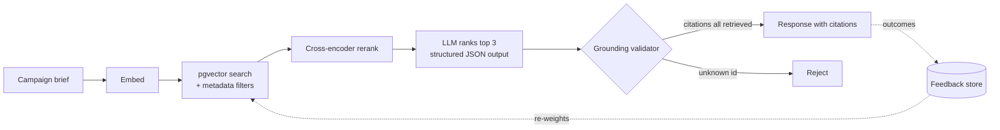

<p align="center"></p>

<h1 align="center">campaign-lookalike-rag — Lookalike Campaign Retrieval</h1>

<p align="center"><strong>A RAG service that finds comparable past ad campaigns for a new brief and cites every source it uses.</strong></p>

<p align="center">
  <a href="https://github.com/dakshshukla10/campaign-lookalike-rag/actions/workflows/ci.yml"></a>
  <a href="LICENSE"></a>
  
  
</p>
<p align="center">
  
  
  
  
</p>

> 🚧 **Status: in active development**
> _Phase 1 complete — see the roadmap below. Retrieval, reranking and LLM ranking are not built yet._

---

## 💡 Why

Brands planning a retail-media campaign want to know how similar past campaigns performed before they spend. This service takes a new campaign brief, finds comparable past campaigns, and explains why they are comparable. Every claim points back to a source campaign, and a validator rejects any citation that was not actually retrieved, so the model cannot invent evidence.

---

## ✨ Features

| Feature | Status |
| :-- | :-: |
| Spring Boot skeleton with `api`, `domain`, `retrieval`, `rerank`, `grounding`, `eval`, `feedback` packages | ✅ |
| `POST /v1/lookalikes` with the final JSON shape (returns a stub today) | ✅ |
| Grounding validator that rejects citations not in the retrieved set (unit tested) | ✅ |
| Docker Compose with pgvector Postgres and Redis, synthetic sample data | ✅ |
| CI that builds and runs tests on every push | ✅ |
| Ingestion and embedding into pgvector | 🚧 |
| Retrieval with metadata filters (category, audience, channel, objective) | 🚧 |
| Cross-encoder reranking | 📋 |
| LLM top-3 ranking with structured JSON output | 📋 |
| Eval harness (coverage@1, coverage@3, grounding rate, regression gate) | 📋 |
| Feedback loop that re-weights retrieval from past outcomes | 📋 |

🚧 means the work is planned and its issues are open, but no implementation has landed.

---

## 🏗️ Architecture



Only the grounding validator and the HTTP endpoint are real today; the other boxes are placeholders. See [docs/architecture.md](docs/architecture.md) for details.

---

## 🧰 Tech Stack

| Layer | Choice | Status |
| :-- | :-- | :-: |
| Language / framework | Java 21, Spring Boot 3.5 (Gradle Kotlin DSL) | ✅ |
| Vector store | Postgres + pgvector (in `docker-compose.yml`) | 🚧 |
| Cache | Redis (in `docker-compose.yml`) | 🚧 |
| LLM orchestration | Spring AI | 📋 |
| Testing | JUnit 5, Spring Boot Test | ✅ |
| CI | GitHub Actions | ✅ |

---

## 🚀 Quickstart

Requires Java 21 and Docker.

```bash
# 1. Start Postgres (pgvector) and Redis. The app does not use them yet.
docker compose up -d

# 2. Run the app
./gradlew bootRun

# 3. Call the endpoint (returns a stub in Phase 1)
curl -s -X POST localhost:8080/v1/lookalikes \
  -H 'Content-Type: application/json' \
  -d '{"description":"Back-to-school promo for parents","category":"grocery","channel":"display","objective":"conversion","budgetUsd":50000}'
```

Run the tests with `./gradlew test`. Copy `.env.example` to `.env` for settings; API keys are read from environment variables only and are never committed.

Sample data lives in [`data/`](data/) and is entirely synthetic.

---

## 📊 Evaluation

No results are published yet. The harness (Phase 4) will report:

- **coverage@1 / coverage@3:** how often a labelled expected campaign appears in the top 1 / top 3
- **grounding rate:** the share of citations that point at a retrieved campaign
- **regression check:** the same metrics compared across prompt and model changes, so CI can fail on a drop

---

## 🗺️ Roadmap

| Phase | Scope | Status | Milestone |
| :-- | :-- | :-: | :-- |
| 1 | Scaffold & grounding validator | ✅ | [Phase 1](https://github.com/dakshshukla10/campaign-lookalike-rag/milestone/1) |
| 2 | Ingestion + pgvector retrieval with metadata filters | 🚧 | [Phase 2](https://github.com/dakshshukla10/campaign-lookalike-rag/milestone/2) |
| 3 | Reranking + LLM structured ranking | 📋 | [Phase 3](https://github.com/dakshshukla10/campaign-lookalike-rag/milestone/3) |
| 4 | Eval harness + CI regression gate | 📋 | [Phase 4](https://github.com/dakshshukla10/campaign-lookalike-rag/milestone/4) |
| 5 | Feedback loop | 📋 | [Phase 5](https://github.com/dakshshukla10/campaign-lookalike-rag/milestone/5) |

Open issues per phase:

- **Phase 2:** [#5 CSV to Postgres](https://github.com/dakshshukla10/campaign-lookalike-rag/issues/5), [#6 embeddings in pgvector](https://github.com/dakshshukla10/campaign-lookalike-rag/issues/6), [#7 filtered similarity search](https://github.com/dakshshukla10/campaign-lookalike-rag/issues/7), [#8 Testcontainers tests](https://github.com/dakshshukla10/campaign-lookalike-rag/issues/8)
- **Phase 3:** [#9 reranker](https://github.com/dakshshukla10/campaign-lookalike-rag/issues/9), [#10 LLM structured ranking](https://github.com/dakshshukla10/campaign-lookalike-rag/issues/10), [#11 grounding rejections](https://github.com/dakshshukla10/campaign-lookalike-rag/issues/11)
- **Phase 4:** [#12 labelled briefs](https://github.com/dakshshukla10/campaign-lookalike-rag/issues/12), [#13 metrics](https://github.com/dakshshukla10/campaign-lookalike-rag/issues/13), [#14 CI regression gate](https://github.com/dakshshukla10/campaign-lookalike-rag/issues/14)
- **Phase 5:** [#15 record outcomes](https://github.com/dakshshukla10/campaign-lookalike-rag/issues/15), [#16 re-weight retrieval](https://github.com/dakshshukla10/campaign-lookalike-rag/issues/16), [#17 offline replay](https://github.com/dakshshukla10/campaign-lookalike-rag/issues/17)

---

## 📁 Project Structure

```text
.
├── build.gradle.kts
├── docker-compose.yml          # pgvector Postgres + Redis
├── .env.example
├── data/                       # synthetic sample campaigns + generator
├── docs/
│   ├── architecture.md
│   └── assets/banner.svg
├── .github/workflows/ci.yml
└── src/
    ├── main/java/io/github/dakshshukla/lookalike/
    │   ├── api/                # REST controller, request/response, service
    │   ├── domain/             # Campaign, CampaignBrief, Recommendation, Citation
    │   ├── retrieval/          # retriever interface (placeholder impl)
    │   ├── rerank/             # reranker + LLM ranker interfaces (placeholders)
    │   ├── grounding/          # GroundingValidator (implemented)
    │   ├── eval/               # eval harness (planned)
    │   └── feedback/           # feedback store (planned)
    └── test/java/...           # JUnit 5 tests
```

---

## 📄 License

[MIT](LICENSE) © Daksh Shukla

---

<p align="center"><sub>Built with ❤️ by <a href="https://github.com/dakshshukla10">Daksh Shukla</a></sub></p>
