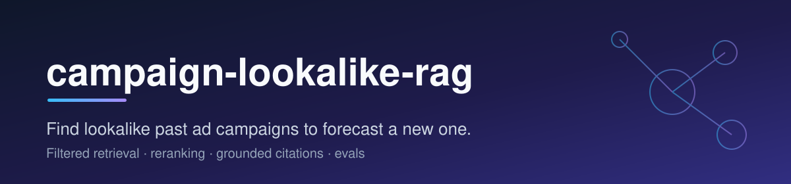
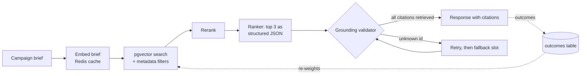

<p align="center"></p>

<h1 align="center">campaign-lookalike-rag</h1>

<p align="center"><strong>A RAG service that finds past ad campaigns similar to a new brief: embeddings, metadata filtering, reranking, structured LLM ranking with cited campaign IDs, a grounding validator, and coverage@K evals.</strong></p>

<p align="center">
  <a href="https://github.com/dakshshukla10/campaign-lookalike-rag/actions/workflows/ci.yml"></a>
  <a href="LICENSE"></a>
  
  
  
</p>
<p align="center">
  
  
  
  
</p>

---

## Why

Someone planning a retail-media campaign wants to know how comparable past campaigns performed before spending. This service takes a campaign brief, finds similar past campaigns, picks the three closest and says why. Every claim cites a campaign id, and a validator rejects any id that retrieval did not return, so the ranking model cannot make up evidence.

It runs fully offline by default. The embedder and the ranking model are deterministic stand-ins that go through the same Spring AI interfaces and the same JSON parsing as a real provider, so tests and CI need no API key. Setting a profile switches to any OpenAI-compatible endpoint.

---

## Status

All five phases are built. The sample data is synthetic and the default models are offline stand-ins, which limits what the numbers mean (see [Evaluation](#evaluation)).

| Area | State |
| :-- | :-- |
| CSV load into Postgres (Flyway schema, idempotent upsert, `./gradlew ingest`) | Done |
| Campaign embeddings in pgvector through Spring AI `PgVectorStore` | Done |
| Cosine search with category, audience, channel and objective filters | Done |
| Redis cache for embeddings, fails open when Redis is down | Done |
| Reranking: lexical cross-scorer by default, chat-model reranker as an option | Done. The model reranker is tested with a stub model only |
| Top-3 ranking with Spring AI structured output and cited campaign ids | Done |
| Grounding validator, retry with the rejected ids, fallback slots | Done |
| Real provider (OpenAI-compatible, including a local Ollama server) | Wired and tested against a local stand-in HTTP server. Never run against a hosted model |
| Eval harness: coverage@1, coverage@3, grounding rate, CI gate | Done |
| Outcomes endpoint, outcome re-weighting, offline replay | Done. Re-weighting is off by default |
| Hosted demo: Dockerfile, `demo` profile, landing page, `render.yaml` | Built and run in Docker. Not deployed yet (see [Deploy](#deploy)) |

---

## Architecture



[docs/architecture.md](docs/architecture.md) covers each stage, the retry and fallback rules and the known limits.

---

## Tech stack

| Layer | Choice |
| :-- | :-- |
| Language and framework | Java 21, Spring Boot 3.5, Gradle Kotlin DSL |
| LLM and embeddings | Spring AI 1.1: `EmbeddingModel`, `ChatClient`, `BeanOutputConverter`, `VectorStore` |
| Vector store | Postgres 16 with pgvector (HNSW, cosine), Flyway migrations |
| Cache | Redis 7, embeddings keyed by a hash of the text |
| Tests | JUnit 5, Spring Boot Test, Testcontainers (pgvector and Redis) |
| CI | GitHub Actions, runs the tests and the eval gate |

---

## Quickstart

Requires Java 21 and Docker.

```bash
# 1. Start Postgres (pgvector) and Redis
docker compose up -d

# 2. Load the 120 synthetic campaigns and embed them
./gradlew ingest

# 3. Run the service
./gradlew bootRun

# 4. Ask for lookalikes
curl -s -X POST localhost:8080/v1/lookalikes \
  -H 'Content-Type: application/json' \
  -d '{"description":"Stock a family pantry with rice and lentils for weekly meals","category":"grocery","budgetUsd":50000}'

# 5. Tell the service how a recommendation worked out
curl -s -X POST localhost:8080/v1/outcomes \
  -H 'Content-Type: application/json' \
  -d '{"campaignId":"C-0094","helpful":true}'
```

Only `description` is required in the brief. `category`, `audience`, `channel` and `objective` act as exact-match filters when set. `budgetUsd` only affects reranking.

Run the tests with `./gradlew test` (starts a pgvector Postgres and a Redis container through Testcontainers) and the eval gate with `./gradlew eval`. Stop the compose stack with `docker compose down -v` when you are done.

### Using a real model

```bash
set -a; source .env; set +a      # see .env.example
export SPRING_PROFILES_ACTIVE=openai
./gradlew bootRun
```

The `openai` profile turns on Spring AI's OpenAI chat and embedding models. Point `OPENAI_BASE_URL` at `http://localhost:11434` to use a local Ollama server. The vector table is created with `LOOKALIKE_AI_EMBEDDING_DIMENSIONS` columns, so set it to the embedding model's size and re-ingest after switching models. `lookalike.rerank.mode=model` also lets the chat model score candidates.

### Settings

| Property | Default | Meaning |
| :-- | :-- | :-- |
| `lookalike.ai.provider` | `offline` | `offline` or `openai` (set by the profile) |
| `lookalike.rerank.mode` | `lexical` | `lexical`, `none` or `model` |
| `lookalike.ranking.max-attempts` | `2` | Ranker calls before missing slots are filled from reranked order |
| `lookalike.cache.enabled` | `true` | Cache embeddings in Redis |
| `lookalike.feedback.reweight.enabled` | `false` | Re-weight retrieval scores with recorded outcomes |
| `lookalike.feedback.reweight.strength` | `0.05` | Largest score change outcomes can cause, as a fraction |
| `lookalike.feedback.endpoint.enabled` | `true` | Register `POST /v1/outcomes`. The `demo` profile turns it off |
| `lookalike.ratelimit.enabled` | `false` | Per-IP limit on `/v1/**`, in memory. The `demo` profile turns it on |
| `lookalike.ratelimit.per-minute` | `30` | Requests per client per minute when the limit is on |
| `lookalike.seed.enabled` | `false` | Load `lookalike.seed.path` into an empty `campaigns` table at startup. The `demo` profile turns it on |

---

## Deploy

Hosted demo: TBD

The repository ships a `Dockerfile` and a `render.yaml` Blueprint for a free web service. The image runs the `demo` profile, which keeps the offline models, turns `POST /v1/outcomes` off, limits each client to 30 requests a minute on `/v1/**`, and loads `data/sample_campaigns.csv` into an empty `campaigns` table at startup. A restart finds the rows and skips the load. The landing page at `/` has a form that calls `POST /v1/lookalikes`.

Free hosting has costs. A free Render service sleeps after 15 idle minutes, and the next request waits for the container to start. The wake-up numbers below were measured on a laptop, not on Render.

### Environment variables

| Variable | Default | Use |
| :-- | :-- | :-- |
| `PORT` | `8080` | HTTP port. Render sets it |
| `SPRING_PROFILES_ACTIVE` | `demo` in the image | Set to something else to run the image without the demo restrictions |
| `POSTGRES_HOST`, `POSTGRES_PORT`, `POSTGRES_DB`, `POSTGRES_USER`, `POSTGRES_PASSWORD` | local compose values | Database connection |
| `POSTGRES_SSLMODE` | `prefer` | Use `require` for a hosted database such as Neon |
| `SPRING_FLYWAY_URL`, `SPRING_FLYWAY_USER`, `SPRING_FLYWAY_PASSWORD` | unset | Optional separate connection for migrations. Use it when the app connects through a transaction pooler, because Flyway takes a database lock that a pooler can break. The URL is a full JDBC URL, for example `jdbc:postgresql://<direct-host>/<db>?sslmode=require` |
| `REDIS_HOST`, `REDIS_PORT` | `localhost`, `6379` | Embedding cache |
| `REDIS_PASSWORD` | empty | Password for the cache |
| `REDIS_SSL` | `false` | `true` for a provider that requires TLS (`rediss://`) |

The database user needs to create the `vector` and `hstore` extensions, which Spring AI does with `CREATE EXTENSION IF NOT EXISTS` when it creates the `vector_store` table. If the provider already has them enabled, the statements do nothing. Redis is optional at runtime: a missing or unreachable cache is logged, the embedder runs without it, and `/actuator/health` stays up in the `demo` profile.

### Render

1. Create a Postgres database with pgvector and a Redis instance. Neon and Upstash have free tiers.
2. In Render, choose New > Blueprint, point it at this repository, and fill in the prompted values from the table above.
3. Check `/actuator/health`, then open `/`.

The rate limit reads the client address that Tomcat takes from `X-Forwarded-For`, and Tomcat only trusts that header from proxies in its default internal ranges. If Render's proxy falls outside them, all visitors share one counter, which still protects the service but lets one visitor use up everyone's allowance. I have not checked this on Render.

### Docker

```bash
docker compose --profile app up --build
```

This starts Postgres, Redis and the application image on `localhost:8080`. The image is built in two stages: Gradle builds the jar, then a JRE image runs it as a non-root user with the serial garbage collector, a 62% heap ceiling and a class-data archive for faster startup.

### Measured on a laptop

Run with `docker run --memory=512m --cpus=0.1` against local Postgres and Redis containers, on an Apple silicon laptop whose Docker VM was shared with other jobs, so treat the figures as rough. One early run during heavy contention took 106 seconds to start; the figures below are from quieter runs.

| What | Result |
| :-- | :-- |
| Spring Boot startup, database already seeded | 52 to 59 seconds |
| Container start to first healthy answer | 62 to 71 seconds |
| Extra time to seed 120 campaigns into an empty database | about 10 seconds |
| Startup without the class-data archive | 76 seconds in one run |
| Memory after 40 requests to `POST /v1/lookalikes` | 228 MiB used of 512 MiB, no out-of-memory kill |
| First request after startup | 9.4 seconds |
| Later requests (median, 90th percentile) | 0.28 seconds, 0.45 seconds |

Lazy bean initialisation brought startup down to 43 seconds but moved the work into the first health check, so the container was healthy no sooner (74 seconds), and the image does not use it.

---

## Evaluation

`./gradlew eval` runs 40 labelled briefs through the whole pipeline with the default offline models and compares the result with `eval/baseline.json`. The data is synthetic: campaigns and briefs come from word lists, and labels come from the generator's theme assignment by rule. These numbers show the pipeline works on that data. They are not a measure of quality on real campaigns.

| Metric (synthetic data, 40 briefs) | Value |
| :-- | :-- |
| coverage@1 | 95.0% |
| coverage@3 | 95.0% |
| grounding rate (ranker's first answer) | 100.0% |
| precision@3 | 86.7% |

Coverage is the share of briefs where the first recommendation, or one of the first three, cites an expected campaign. The two misses are retrieval misses. The grounding rate is 100% because the offline ranker copies ids from its prompt, so the gate mostly guards against code that breaks citations. CI fails when coverage falls more than 2.5 points below the baseline or any citation is ungrounded. [docs/evaluation.md](docs/evaluation.md) has the details, including what the feedback replay showed.

---

## Project structure

```text
.
├── build.gradle.kts
├── Dockerfile                    # multi-stage image for the hosted demo
├── docker-compose.yml            # pgvector Postgres + Redis, plus the app under --profile app
├── render.yaml                   # Render Blueprint
├── .env.example
├── data/                         # synthetic campaigns, labelled briefs, generator
├── eval/baseline.json            # reference metrics for the CI gate
├── docs/
│   ├── architecture.md
│   └── evaluation.md
├── .github/workflows/ci.yml
└── src/
    ├── main/java/io/github/dakshshukla/lookalike/
    │   ├── api/                  # controller, request/response, LookalikeService pipeline, rate limit
    │   ├── domain/               # Campaign, CampaignBrief, ScoredCampaign, Recommendation, Citation
    │   ├── ingest/               # CSV reader, campaign repository, ingest service, demo seeder
    │   ├── ai/                   # offline embedder and offline chat model
    │   ├── cache/                # Redis embedding cache
    │   ├── retrieval/            # pgvector retriever, feedback-weighted retriever
    │   ├── rerank/               # rerankers, ranker, prompt and payload records
    │   ├── grounding/            # GroundingValidator
    │   ├── eval/                 # EvalHarness, report, baseline gate
    │   ├── feedback/             # outcomes store, endpoint, score weights
    │   └── config/               # model, retrieval and rerank wiring
    └── test/java/...             # unit tests and Testcontainers integration tests
```

---

## License

[MIT](LICENSE) © Daksh Shukla
