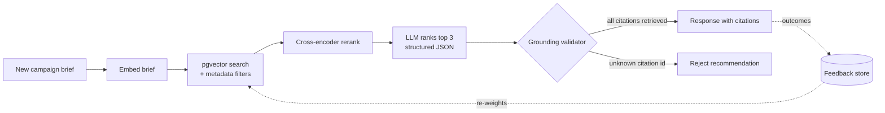

# Architecture

This document describes the intended design and marks what exists today. Anything not marked
"implemented" is planned.

## Request flow



| Stage | Package | Status |
| --- | --- | --- |
| HTTP entry point `POST /v1/lookalikes` | `api` | Implemented (returns a stub body) |
| Domain records (`Campaign`, `CampaignBrief`, `Recommendation`, `Citation`) | `domain` | Implemented |
| Embed + filtered vector search | `retrieval` | Interface plus an empty placeholder; real retrieval is Phase 2 |
| Cross-encoder reranking | `rerank` | Interface plus a pass-through placeholder; Phase 3 |
| LLM structured ranking | `rerank` | Interface plus a no-op placeholder; Phase 3 |
| Grounding validation | `grounding` | Implemented and unit tested |
| Evaluation harness | `eval` | Empty interface; Phase 4 |
| Feedback loop | `feedback` | Empty interface; Phase 5 |

## Grounding validator

The LLM is only allowed to cite campaigns that retrieval actually returned for this request.
`GroundingValidator.validate(recommendations, retrieved)` checks every citation:

- A recommendation with no citations is rejected (`NO_CITATIONS`).
- A null or blank cited id is rejected (`BLANK_ID`).
- A cited id that is not in the retrieved set is rejected (`NOT_RETRIEVED`).
- One bad citation rejects the whole recommendation. Ids are matched exactly, with no trimming
  or case folding, so an id is never silently "repaired".

The result lists accepted recommendations, every violation, and the counts of citations checked
and grounded. The evaluation harness will use those counts to report a grounding rate.

## Response shape

`POST /v1/lookalikes` takes a brief and returns the shape below. In Phase 1 `recommendations`
is always empty and `status` is `"stub"`. The populated example is illustrative only, with
made-up ids.

```json
{
  "status": "ok",
  "retrievedCount": 20,
  "recommendations": [
    {
      "rank": 1,
      "summary": "Why this past campaign is a good comparison",
      "citations": [{ "campaignId": "C-0007", "reason": "Same category, channel and objective" }]
    }
  ],
  "grounding": { "citationsChecked": 1, "citationsGrounded": 1, "rejected": [] },
  "notes": []
}
```

## Planned data flow

- **Ingestion (Phase 2):** campaign rows go into Postgres; text fields are embedded and stored
  in a pgvector column. Metadata (category, audience, channel, objective) stays in ordinary
  columns so it can be used as filters.
- **Retrieval (Phase 2):** embed the brief, filter on whichever metadata fields were supplied,
  and return the top-K nearest campaigns.
- **Rerank and rank (Phase 3):** a cross-encoder re-scores the candidates, then an LLM picks
  and explains the top 3 as structured JSON with citations.
- **Cache:** Redis is in the compose file for caching; nothing uses it yet.
- **Eval (Phase 4):** labelled briefs measure coverage@1, coverage@3 and grounding rate, and CI
  can fail on a regression.
- **Feedback (Phase 5):** recorded outcomes of past recommendations re-weight retrieval.
