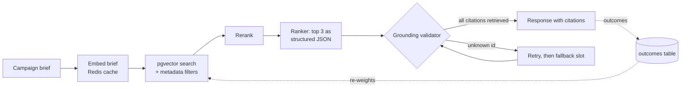

# Architecture

## Request flow



| Stage | Package | What it does |
| --- | --- | --- |
| HTTP | `api` | `POST /v1/lookalikes` takes a brief and returns recommendations, grounding counts and notes. `LookalikeService` runs the pipeline. |
| Ingestion | `ingest` | Reads the CSV, upserts rows into `campaigns`, and adds one vector document per campaign to the Spring AI `VectorStore`. |
| Embedding | `ai`, `cache` | `HashingEmbeddingModel` is the offline default. `CachingEmbeddingModel` wraps whichever model is active and keeps vectors in Redis. |
| Retrieval | `retrieval` | `PgVectorCampaignRetriever` runs a cosine search with the filters that the brief sets. `FeedbackWeightedRetriever` can wrap it. |
| Reranking | `rerank` | `LexicalCrossScorerReranker` by default, `ModelReranker` with a real provider, or no reranking. |
| Ranking | `rerank` | `LlmRecommendationRanker` asks a Spring AI `ChatClient` for a `RankingPayload` and maps it to cited recommendations. |
| Grounding | `grounding` | `GroundingValidator` rejects any recommendation that cites a campaign the retriever did not return. |
| Evaluation | `eval` | `EvalHarness` scores labelled briefs; `EvalGate` compares the result with `eval/baseline.json`. |
| Feedback | `feedback` | Stores outcomes and turns them into score multipliers. |

## Models and providers

Everything that would call a model sits behind a Spring AI interface, so the pipeline code is the
same with or without a real provider.

- `EmbeddingModel`: `HashingEmbeddingModel` hashes unigrams and bigrams into 256 positive
  weights and normalises them. It matches shared words, not meaning. With the `openai` profile
  the Spring AI OpenAI embedding model is used instead.
- `ChatModel`: `OfflineChatModel` reads the real prompt, keeps the candidates in reranked order
  and writes the answer as the JSON that `BeanOutputConverter` expects. Every id and number in it
  is copied from a candidate. With the `openai` profile the Spring AI OpenAI chat model answers.
- The `openai` profile talks to any OpenAI-compatible endpoint, so a local Ollama server works by
  setting `OPENAI_BASE_URL`. The provider path is tested against a local stand-in HTTP server
  (`OpenAiProviderPipelineTest`), not against a hosted model. The vector table width must equal
  the embedding model's size.

## Retrieval

The brief text (description plus any filter values) is embedded and compared with the campaign
vectors by cosine similarity. Category, audience, channel and objective become exact-match
filters on the vector document's metadata when the brief sets them. Filter values are lower-cased
and must be plain slugs, because they end up inside a JSON path expression. Results are joined
back to the `campaigns` table so the rest of the pipeline sees full rows.

## Reranking

The default reranker scores each (brief, campaign) pair on four features, renormalising when one
does not apply:

| Feature | Weight |
| --- | --- |
| idf-weighted share of brief words found in the campaign text | 0.45 |
| share of brief word pairs found in the campaign text | 0.15 |
| agreement on the category, audience, channel and objective that the brief sets | 0.25 |
| budget closeness on a log scale, when the brief has a budget | 0.15 |

The final score is 0.4 times the retrieval score plus 0.6 times that cross score. These weights
are set by hand. `lookalike.rerank.mode=model` swaps in a chat-model scorer and falls back to the
lexical scores when the provider fails or leaves candidates out.

## Ranking, grounding and fallback

```
rank  ->  validate  ->  clean?            yes: done
                         |no
                         v
                    retry once with the rejected ids named (lookalike.ranking.max-attempts)
                         |
                         v
                    validate again, keep the better answer
                         |
                         v
          still short? fill the missing slots from reranked order, source = FALLBACK
```

A recommendation is accepted only if all of its citations point at retrieved campaigns. The
response lists the violations that survived the retries, and `notes` says when a retry or a
fallback happened. `status` is `ok`, `degraded` (a fallback slot was used) or `no_matches`. A
ranker call that throws, or an answer that is not valid JSON, counts as an empty answer.

The eval harness reads the first attempt from `PipelineResult`, so the grounding rate shows what
the ranker did before the pipeline cleaned up after it.

## Feedback

`POST /v1/outcomes` stores `{campaignId, helpful}` rows in `outcomes`. With
`lookalike.feedback.reweight.enabled=true` the retriever asks for three times as many candidates,
multiplies each score by `1 + strength * signal` and cuts back to the requested size. The signal
is `2 * (helpful + 1) / (total + 2) - 1`, so a campaign with no reports keeps its score and one
report moves it only a little. The default strength is 0.05.

Weights belong to a campaign, not to a campaign and brief pair. A campaign that was helpful for
one brief is lifted for unrelated briefs too, which is why the strength is small. See
[evaluation.md](evaluation.md) for what the replay showed.

## Response shape

```json
{
  "status": "ok",
  "retrievedCount": 15,
  "recommendations": [
    {
      "rank": 1,
      "summary": "Why this past campaign is a good comparison",
      "citations": [{ "campaignId": "C-0094", "reason": "shares the terms pantry, rice; same category grocery" }],
      "source": "MODEL"
    }
  ],
  "grounding": { "citationsChecked": 3, "citationsGrounded": 3, "rejected": [] },
  "notes": []
}
```

## Storage

Flyway owns `campaigns` and `outcomes`. Spring AI creates the `vector_store` table on startup
with the configured width, an HNSW index and cosine distance. The vector document id is the
campaign id, so loading the same file twice replaces rows.

## Known limits

- The offline embedder only sees shared words. On the synthetic data that is enough, on real
  campaign text it would not be.
- Nothing here has been run against a hosted model. The provider code paths are covered by tests
  against a local stand-in server only.
- The endpoints have no authentication.
- Filters are exact matches. A brief that names a category with no campaigns gets no matches.
